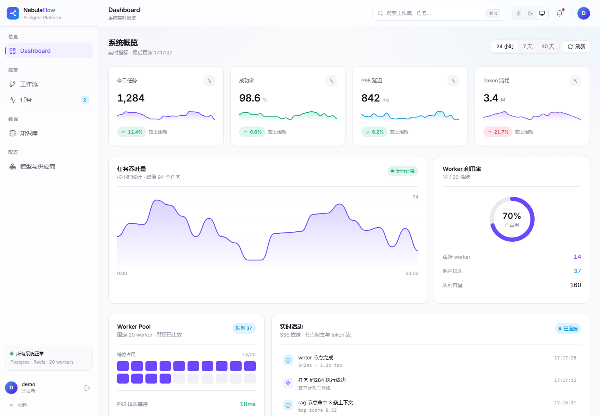
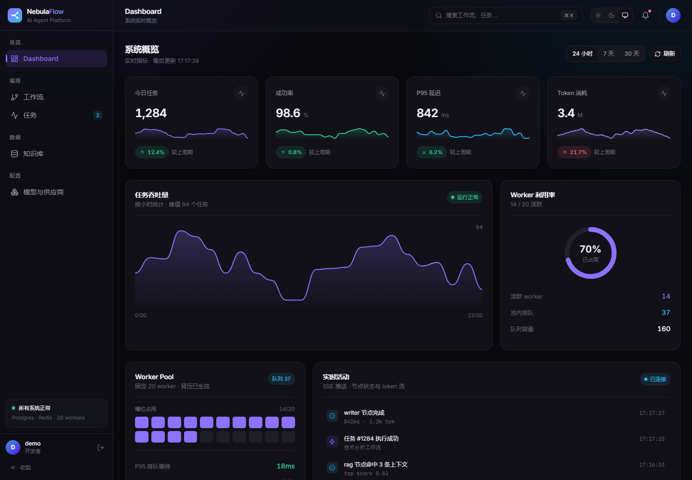
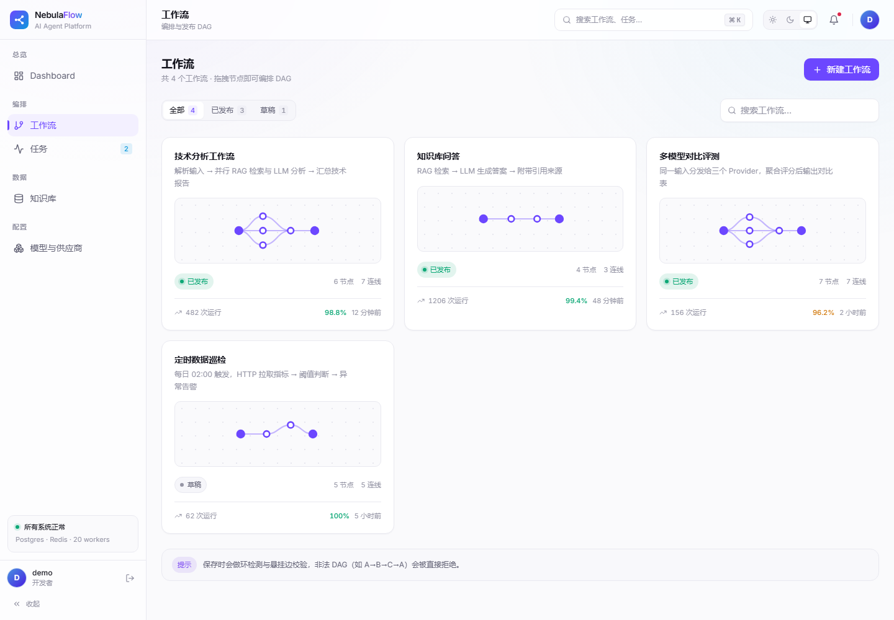
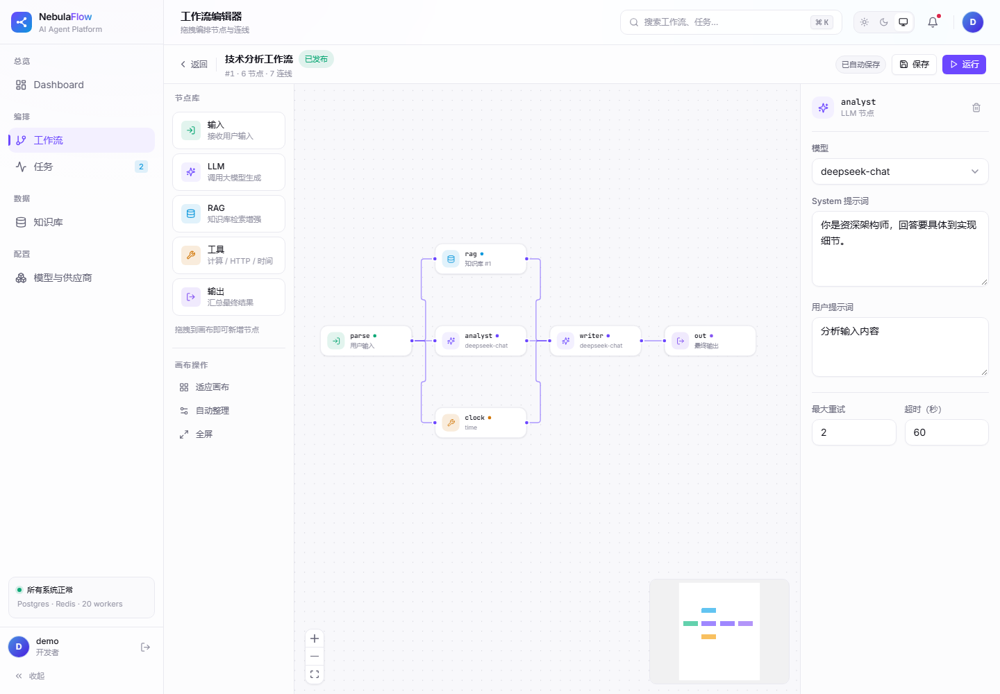
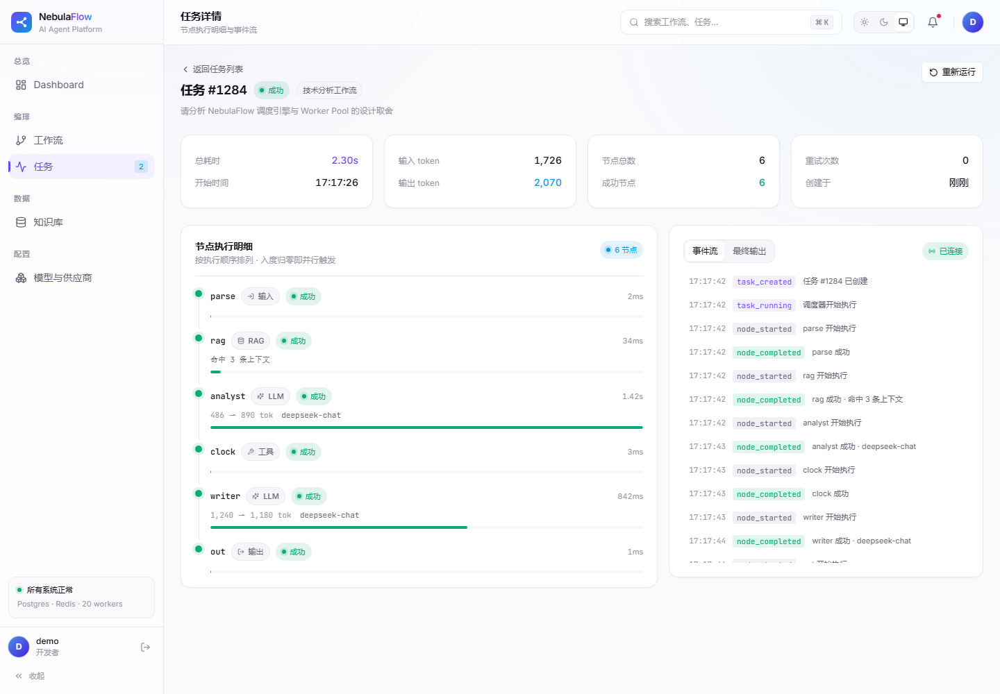
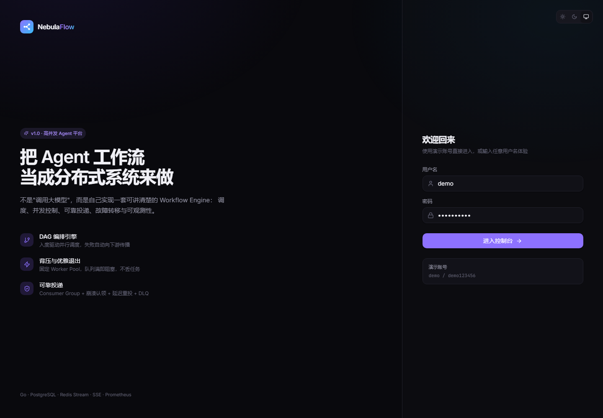

# NebulaFlow Web Framework (`web-next`)

独立的前端框架与设计系统，为 NebulaFlow 控制台提供现代化的视觉基座。
**双主题可切换**（浅色 / 深色 / 跟随系统），零后端依赖即可完整预览。

---

## 预览

| Dashboard（浅色） | Dashboard（深色） |
|---|---|
|  |  |

| 工作流编排 | DAG 编辑器 |
|---|---|
|  |  |

| 任务详情 | 登录页（深色） |
|---|---|
|  |  |

> 截图由 Edge headless 在 1440×1000 视口下实拍，非设计稿。

---

## 设计取向

| 维度 | 选择 | 理由 |
|---|---|---|
| 主色 | 紫罗兰 `#6C47FF` / `#8D71FF` | 避开"企业蓝"的既视感，更清新、更少撞色 |
| 层次 | 边框 + 极浅阴影 | 比重投影更轻，是"现代"与"老气"的主要分野 |
| 圆角 | 10 / 14 / 18px | 偏大圆角带来松弛感 |
| 留白 | 卡片 20px、区块 24px | 避免密集拥挤 |
| 字体 | Inter + JetBrains Mono | UI 用无衬线，仅代码/数字用等宽（旧版全站等宽，偏工程味） |
| 环境光 | 极淡双色径向渐变 | "清新"观感的主要来源，不抢内容 |
| 动效 | 150–400ms，`cubic-bezier(0.32,0.72,0,1)` | 干脆、有回弹感，不拖沓 |

---

## 主题系统

核心是**语义化 token**：组件只写 `bg-surface` / `text-fg-muted` / `border-line`，
从不写死具体颜色。因此换主题只需要换一组 CSS 变量，组件零改动。

```
src/index.css
  :root  { --c-bg: 250 250 252;  --c-surface: 255 255 255;  --c-brand: 108 71 255; ... }
  .dark  { --c-bg:   9   9  13;  --c-surface:  17  17  23;  --c-brand: 141 113 255; ... }

tailwind.config.js
  colors: {
    bg:      "rgb(var(--c-bg) / <alpha-value>)",
    surface: "rgb(var(--c-surface) / <alpha-value>)",
    brand:   "rgb(var(--c-brand) / <alpha-value>)",
    ...
  }
```

写成 `rgb(var(--x) / <alpha-value>)` 而不是直接 `var(--x)`，
是为了让 `bg-brand/12`、`ring-brand/35` 这类透明度修饰符继续可用。

### 变量清单

| 分组 | 变量 |
|---|---|
| 背景层次 | `--c-bg` `--c-surface` `--c-surface-2` `--c-surface-3` |
| 描边 | `--c-line` `--c-line-strong` |
| 前景 | `--c-fg` `--c-fg-muted` `--c-fg-subtle` |
| 主色 | `--c-brand` `--c-brand-fg` `--c-brand-soft` `--c-brand-ring` |
| 辅助色 | `--c-mint` `--c-sky` `--c-amber` `--c-rose` `--c-violet` |
| 阴影 | `--sh-xs` `--sh-sm` `--sh-md` `--sh-lg` `--sh-glow` |
| 环境光 | `--ambient-1` `--ambient-2` `--ambient-strength` |

### 切换与防闪烁

`index.html` 内联脚本在**首帧之前**就根据 `localStorage` / 系统偏好设置 `<html>.dark`，
避免浅色用户看到一瞬深色底、深色用户看到白闪。

运行时状态在 `src/lib/theme.ts`（Zustand），支持 `light | dark | system` 三态，
`system` 模式下监听 `prefers-color-scheme` 变化实时跟随。

---

## 目录结构

```
web-next/
├── index.html                 # 含防主题闪烁内联脚本
├── tailwind.config.js         # 语义色 → CSS 变量映射
├── vite.config.ts             # 端口 5174，/api 代理到 8080
└── src/
    ├── index.css              # ★ 设计系统：token + 组件层 + 工具类
    ├── App.tsx                # 路由表 + 登录守卫（RequireAuth）+ 401 跳转注册
    ├── main.tsx
    ├── api/
    │   ├── client.ts          # fetch 封装：超时 / Bearer 注入 / 401 清会话
    │   ├── index.ts           # realApi：真实 HTTP 实现（默认）
    │   ├── mock-api.ts        # mockApi：本地演示数据（VITE_USE_MOCK=true）
    │   ├── service.ts         # ApiService 契约（两个实现共用）
    │   ├── sse.ts             # fetch+reader 的 SSE 客户端（退避重连 / 终态停止）
    │   ├── transform.ts       # snake_case → camelCase / 安全取值
    │   └── config.ts          # USE_MOCK / API_BASE_URL
    ├── lib/
    │   ├── theme.ts           # 主题 store（light/dark/system）
    │   ├── session.ts         # 会话 store（真实登录 + token 持久化）
    │   ├── auth.ts            # token 存取 / 401 通知
    │   ├── mock.ts            # 演示数据（仅 mock 模式使用）
    │   └── utils.ts           # cn / 时间 / 时长格式化
    ├── components/
    │   ├── ui/                # ★ 基础组件库
    │   │   ├── Button.tsx     #   Button / IconButton（5 种 variant）
    │   │   ├── Card.tsx       #   Card / CardHeader / SectionTitle
    │   │   ├── Badge.tsx      #   Badge / StatusDot / StatusBadge / statusMeta
    │   │   ├── Field.tsx      #   Field / Input / Textarea / Select
    │   │   ├── Charts.tsx     #   Sparkline / AreaChart / RingProgress / BarSeries
    │   │   ├── Feedback.tsx   #   EmptyState / Progress / Skeleton
    │   │   ├── Segmented.tsx  #   分段控件
    │   │   ├── Avatar.tsx     #   确定性渐变头像
    │   │   ├── Stat.tsx       #   Stat / MiniStat
    │   │   └── index.ts       #   统一出口
    │   └── shell/
    │       ├── AppShell.tsx   # 外壳：侧边栏 + 顶栏 + 内容区
    │       ├── Sidebar.tsx    # 可折叠侧边栏（分组导航 + 激活指示条）
    │       ├── Topbar.tsx     # 玻璃拟态顶栏（搜索 / 主题 / 通知）
    │       ├── ThemeToggle.tsx
    │       └── Brand.tsx      # 品牌标记（DAG 扇出字形）
    └── pages/
        ├── Login.tsx          # 分栏登录页（品牌区 + 表单）
        ├── Dashboard.tsx      # KPI + 趋势图 + Worker 槽位 + 活动流
        ├── Workflows.tsx      # 卡片网格 + 迷你 DAG 缩略图
        ├── WorkflowEditor.tsx # ★ 画布 + 节点库 + 属性检查器
        ├── Tasks.tsx          # 任务表格
        ├── TaskDetail.tsx     # 节点时间线 + 事件流 + 输出
        ├── Knowledge.tsx      # 文档列表 + 上传区 + 检索打分
        └── Models.tsx         # Provider 卡片 + 故障转移链路
```

---

## 组件速查

```tsx
import { Button, Card, CardHeader, Badge, StatusBadge, Stat,
         AreaChart, RingProgress, BarSeries, Sparkline,
         Field, Input, Select, Textarea, Segmented,
         EmptyState, Progress, Skeleton, Avatar, MiniStat } from "@/components/ui";
```

### 状态配色是统一的

`StatusBadge` 内部维护一张**领域状态 → 视觉语义**映射表，
保证同一个 `succeeded` 在 Dashboard、任务列表、详情页都是同一种绿：

| 状态 | 语义 | 色 |
|---|---|---|
| `succeeded` `published` `indexed` `enabled` | 正常 | mint |
| `running` `indexing` | 进行中（呼吸动画） | sky |
| `pending` `queued` `draft` `cancelled` `skipped` | 中性 | 灰 |
| `failed` `unhealthy` | 异常 | rose |
| `degraded` | 警告 | amber |

新增状态只需在 `Badge.tsx` 的 `STATUS` 表里加一行。

### 图表不依赖第三方库

`Charts.tsx` 里的四个图表全部是手写 SVG：
- 平滑曲线用**水平控制点的三次贝塞尔**（避免样条过冲）
- `preserveAspectRatio="none"` 拉伸时用 `vector-effect="non-scaling-stroke"` 保证线宽不变形
- 悬停气泡用 HTML 定位而非 SVG `<text>`，避免非等比缩放下文字变形

---

## 运行

```bash
cd web-next
npm install
npm run dev        # http://localhost:5174
```

`/api` 与 `/metrics` 已代理到 `http://localhost:8080`，
所以后端起来时可直接联调（后端支持 `STORAGE_MODE=memory` 零依赖启动）。

```bash
npm run build      # 产出 dist/（由 Go 后端托管，单端口）
```

### 真实 API 与 Mock 的切换（默认：真实 API）

`src/api/index.ts` 默认打真实 HTTP；**只有显式打开开关才走 mock**：

| 场景 | 命令 / 配置 | 数据来源 |
| --- | --- | --- |
| 默认（不设变量） | `npm run build` / `npm run dev` | 真实后端 `/api/*` |
| 无后端演示 | `VITE_USE_MOCK=true npm run build`（或 `.env.local` 里写 `VITE_USE_MOCK=true`） | `src/lib/mock.ts` 本地演示数据 |
| 后端在别的地址 | `VITE_API_BASE_URL=http://127.0.0.1:9000` | 该地址的真实后端 |

```bash
# 无后端也能看的演示包
VITE_USE_MOCK=true npm run build
```

开关只影响 `api` 对象指向哪个实现（`realApi` / `mockApi`），
两者实现同一份 `ApiService` 契约（`src/api/service.ts`），
组件层代码完全一致 —— 不存在"mock 能跑、真实接口少一个方法"的情况。

`.env.example` 列出了全部变量；`VITE_*` 变量在 **build 时**被静态替换，
所以改完要重新 build（或让它生效于 `npm run dev` 的启动进程）。

---

## 真实 API 接线说明

数据源的唯一事实来源是 Go 侧：路由见 `internal/api/server.go`，
请求/响应结构见 `internal/api/handlers_*.go` 与 `internal/model/model.go`
（json tag 一律 snake_case，`src/api/transform.ts` 统一转 camelCase）。

### 鉴权

- `POST /api/auth/login`、`POST /api/auth/register`（`src/lib/session.ts`）；
- token 存 `localStorage["nf-token"]`，用户名 / 用户 ID 存 `nf-user` / `nf-user-id`
  （沿用原有 `nf-*` 键名风格）；
- 所有请求由 `apiClient` 注入 `Authorization: Bearer <token>`；
- 任何请求返回 **401** → 清凭据 + 跳登录页（`lib/auth.ts` 的 `notifyUnauthorized`，
  1.5s 去抖，避免同页并发 401 触发多次跳转）；
- 未登录直接访问控制台路由由 `App.tsx` 的 `RequireAuth` 拦下，不发无谓的请求。

### 字段对齐（后端没有的不编造）

| 位置 | 后端实际字段 | 前端处理 |
| --- | --- | --- |
| workflow 列表 | 只有 `model.Workflow`（无 `nodes`/`edges`，也没有 `node_count`/`edge_count`/`runs`/`success_rate`） | 为当前页每条拉一次 `GET /api/workflows/:id`，用真实 `nodes/edges` 长度填"节点数/连线数"、用 `position_x/y` 归一化出缩略图；`runs`/`success_rate` 后端根本没有 → UI 不再展示 |
| task 列表 | `model.Task` 无 `duration_ms`、无 workflow 名、无 token 汇总 | 耗时 = `finished_at - started_at`；工作流名用 `GET /api/workflows` 建 id→name 映射后 join；token 列已移除 |
| provider | 无 `latency_ms` | 延迟不展示（改为展示优先级 + 模型数） |
| 用量 / 成本 | `/api/dashboard/usage` 只有 token 与调用次数，**没有计费字段** | 成本页改成"成本与用量"：只展示真实 token 用量与调用次数，费用/单价相关 UI 与文案全部去掉 |
| 知识库文档 | 文档明细在 `GET /api/knowledge-bases/:id/documents`，列表接口不带 | 选中知识库后单独拉文档；检索命中的来源字段是 `filename`（不是 source） |
| Agent 市场 | `installed_names` 是 `map[string]bool`（JSON 对象） | 转成名字数组后再判断"已安装" |
| 模板 | 列表接口无 `node_count`/`used_count`；`categories` 只返回字符串数组 | 缺的统计字段隐藏；分类的 count 由模板列表本地统计 |

凡是接口没给的数字，UI 一律隐藏或显示 `—`，不渲染 `undefined` / `NaN`，也不显示假数字。

### 分页 / 过滤由前端兜底

后端 `GET /api/tasks` 只接受 `limit`/`offset`（没有 `status`/`q`），
`GET /api/workflows`、`GET /api/agents/marketplace` 也没有搜索参数：
`src/api/index.ts` 一次多取（tasks 取 200 条）后在客户端过滤分页，
所以"筛选/搜索"依然可用，只是以"后端全量返回"为前提。

### SSE 实时事件流

`src/api/sse.ts` 用 `fetch(url, { headers, signal })` + `response.body.getReader()`
自己解析 SSE（原因见下文"为什么不能用 EventSource"）：

- 按 `\n\n` 切帧，解析 `event:` / `data:`（多行 data 用 `\n` 拼接，`:` 开头是心跳注释）；
- 事件名对齐 `internal/task/hub.go`：`snapshot`/`task_created`/`task_running`/
  `task_waiting`/`task_completed`/`task_failed`/`task_cancelled`/`node_started`/
  `node_completed`/`node_failed`/`node_waiting`/`node_skipped`/`node_cancelled`/
  `token`/`log`/`fallback`/`tool_call`/`tool_result`；
- 断线重连走**指数退避 + 抖动**（1s→2s→4s→8s→15s→30s 封顶），
  不是每 3 秒无脑重连（后端 Hub 每用户并发 SSE 上限 10，重连风暴会把自己挡在门外）；
- 终态（`succeeded`/`failed`/`cancelled`，含 snapshot 里的状态）后**停止重连**，
  但保留 1s 宽限期把服务端已补发的 replay 帧读完 —— 否则点开一个跑完的任务，
  事件流里只剩一行 snapshot，看不到 `node_started`/`node_completed` 的回放；
- `close()` 会 abort 当前请求，`TaskDetail` 在卸载时调用。

> **已知后端行为（前端无法规避，实测记录）**：`internal/task/hub.go` 的
> `Subscribe` 会为新订阅者回放该任务最近 64 条事件，但 `unsub` 在
> **最后一个订阅者离开时**会调用 `dropReplayLocked` 把回放缓冲删掉。
> 于是同一个已完成任务：
>
> | 连接次序 | 实际收到的事件 |
> | --- | --- |
> | 第 1 个订阅者 | `snapshot` → `task_created` → `task_running` → `node_started`/`node_completed` ×3 → `task_completed`（10 帧） |
> | 第 2 个订阅者（前者已断开） | 只有 `snapshot`（1 帧） |
>
> 也就是说"打开一个跑完的任务能看到它一步步怎么跑的"只在**首个**订阅者
> 身上成立；第二个人只会看到快照。前端已经做的（1s 排空宽限期、按事件名
> 渲染、终态停重连）都正确，缺的是后端把回放保留得更久一点
> （例如按 TTL 而不是按"无人订阅"回收）。

---

## 视觉验证（无头浏览器）

Windows 下没有 agent-browser，可以用本机 Edge 的 headless 模式截图与测量，
全程不开窗口。本次搭建就是靠它做视觉校对。

**截图** —— `--force-dark-mode` 会让 `prefers-color-scheme: dark` 命中，
从而自动切到深色主题，不必改代码：

```bash
EDGE="/c/Program Files (x86)/Microsoft/Edge/Application/msedge.exe"
"$EDGE" --headless=new --disable-gpu --hide-scrollbars \
  --user-data-dir="$TEMP/edge-shot" --screenshot=out.png \
  --window-size=1440,1000 --virtual-time-budget=9000 \
  "http://127.0.0.1:5174/"
```

**精确测量** —— 截图肉眼看坐标很容易错（本次就误判过一次列宽），
要数值时走 CDP：先起一个带调试端口的实例，

```bash
"$EDGE" --headless=new --remote-debugging-port=9222 --user-data-dir="$TEMP/edge-cdp" about:blank
```

再用 Node（22+ 自带全局 `WebSocket`）连 `http://127.0.0.1:9222/json`，
发 `Emulation.setDeviceMetricsOverride` 固定视口，再 `Runtime.evaluate` 取回测量结果。
本次靠它确认了三件事：

- 表格各列的真实像素宽度（避免"看起来有空白"这类误判）；
- 所有 8 条路由 `scrollWidth === clientWidth`，无横向溢出；
- 主题切换后 `--c-bg` 确实在 `250 250 252 ↔ 9 9 13` 之间切换，且写入 `localStorage`。

> 坑：headless 下 `--window-size` 不可靠（实测拿到 500px 视口），
> 视口必须用 `Emulation.setDeviceMetricsOverride` 设。

---

## 接入真实后端

**已完成**，接线状态与字段对齐见上文《真实 API 接线说明》。这里保留原始设计记录：

1. **API 客户端**：`src/api/client.ts`（fetch + 超时 + token 注入 + 401 处理 + camelCase 转换）。
2. **数据源**：`src/api/index.ts`（真实实现）/ `src/api/mock-api.ts`（演示数据），
   由 `VITE_USE_MOCK` 选择，页面只 `import { api } from "@/api"`。
3. **SSE 实时流**：见 `src/api/sse.ts`。

   ⚠️ **不要用 `new EventSource(...)`**：浏览器的 `EventSource` 无法设置请求头，
   而后端 `/api/tasks/:id/stream` 挂在 `authMiddleware` 之后
   （`internal/api/server.go` 中 `api.Use(authMiddleware(...))` 在路由注册之前），
   缺 `Authorization: Bearer` 一律 401。更糟的是 `EventSource` 会每 ~3s 自动重连，
   单个用户默认限流 120 req/min，开两个详情页就能把该用户所有 API 拖进 429。

   实现方式（后端协议未改动）：`fetch(url, { headers: { Authorization: `Bearer ${token}` }, signal })`
   + `response.body.getReader()`，自己按 `\n\n` 切分 SSE 帧、解析 `event:` / `data:` 行。
4. **登录**：`src/lib/session.ts` 调 `/api/auth/login`、`/api/auth/register`，token 落到 `nf-token`。

### 迁移到主应用

这个目录是**独立可运行**的，确认视觉满意后有两种落地方式：

- **整体替换**：把 `src/` 覆盖到 `web/src/`，保留 `web/` 的 `api/client.ts` 与 `store/auth.ts`。
- **渐进迁移**：只把 `index.css` 的设计系统 + `components/ui/` 搬过去，
  让旧页面逐步换用新的语义色类（`bg-nebula-900` → `bg-surface`）。

---

## 工作流编辑器（DAG Canvas）

`WorkflowEditor` 由 `@xyflow/react` 驱动，是一个可操作的画布而不是静态示意图：

| 能力 | 说明 |
|---|---|
| 拖拽移动节点 | React Flow 内置，位置即 `position` |
| 从节点库拖入新建 | HTML5 DnD，`screenToFlowPosition` 换算坐标，id 自动避让（`tool-2`…） |
| 拖拽手柄连线 | 左右 `Handle` 各司其职；输入节点无 target、输出节点无 source |
| **连线时环检测** | 会成环的连线直接拒绝并提示，见下 |
| 删除节点/连线 | 属性面板的删除按钮，或选中后按 `Delete` / `Backspace` |
| 属性编辑 | 右侧检查器改配置，画布上的节点摘要实时跟着变 |
| 自动整理 | 按拓扑层级分层排布（自实现，无额外依赖） |
| 缩放 / 平移 / MiniMap | 滚轮缩放、拖拽平移，右下角小地图可点可拖 |

### 环检测：把后端的约束提到前端

调度引擎建工作流时会做拓扑排序，非法 DAG（如 `A→B→C→A`）直接拒绝。
前端在**连线当下**就拦住，避免用户存下一个永远跑不起来的图：

```ts
// 从 target 出发 DFS，若能走回 source 说明成环
function createsCycle(edges, source, target) { ... }
```

实测：在 `rag → writer` 已存在时再连 `writer → rag`，连线被拒、边数不变，
并弹出「拒绝连线：writer → rag 会形成环，DAG 必须无环。」

### 两个实现要点

- **手柄样式要用 `.react-flow` 前缀提权**。React Flow 的 `style.css` 以 JS 方式
  import，注入时机晚于全局 `index.css`，同特异性下会把自定义手柄尺寸打回 6px。
  加一层 `.react-flow` 前缀把特异性提到 (0,2,0) 才稳。
- **点阵颜色用 `currentColor` 中转**。SVG attribute 不解析 `var()`，
  所以组件传 `color="currentColor"`，再由 CSS 的 `color` 提供主题变量值。

---

## 已知取舍

1. **未做认证守卫**：路由直接进入 Dashboard，方便预览。加守卫只需在 `App.tsx`
   包一层 `<RequireAuth>`（参考 `session.ts` 的 `loggedIn`）。
2. **`noUnusedLocals` 关闭**：框架骨架阶段放宽，避免演示代码因未用变量编译失败。
   正式接入时可打开。
3. **编辑器尚未回写后端**：画布上的增删改只落在本地 state，`保存` / `运行`
   按钮是占位的。接真实接口时把 `nodes`/`edges` 序列化成 workflow 的
   `nodes`/`edges` payload 提交即可（字段结构已对齐）。
4. **画布宽度有限**：1440 视口下节点库 188px + 属性面板 288px 占去两侧，
   画布约 728px，`fitView` 初始缩放约 0.82。要更大画布可收起侧栏
   （断点：节点库 `lg`、属性面板 `xl`）。
